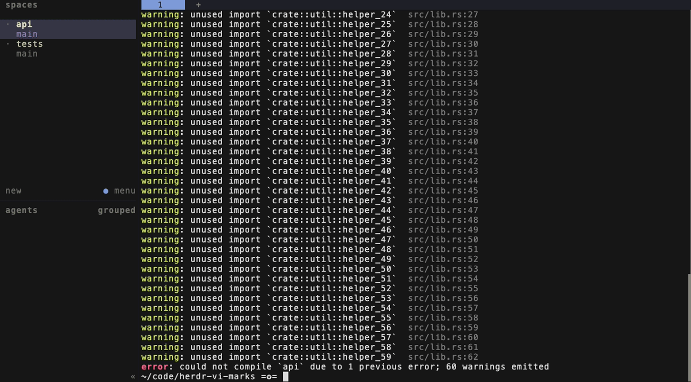

# herdr-vi-marks

Vi-style line marks for [herdr](https://herdr.dev) scrollback.



herdr's copy mode and scrollback have no built-in marks. This plugin adds them:
set a mark at the current scroll position with a letter, jump back to it later
from any workspace or pane, and use `'` to return to where you were before the
last jump, like vi's `''`.

| Keys (recommended) | Then press | Effect |
| --- | --- | --- |
| `prefix+m` | `a`–`z` | Set a mark at the current scroll position |
| `prefix+'` | `a`–`z` | Jump to that mark, switching workspace and pane if needed |
| `prefix+'` | `'` | Jump back to the position before the last jump |
| `prefix+M` | | List all marks with a preview of each line; press a letter to jump |
| `prefix+(` | | Hop to the previous Claude Code block (the `⏺` dot) |
| `prefix+)` | | Hop to the next Claude Code block, or back to the live bottom |

`Esc` or `Ctrl+C` cancels a prompt. Setting a mark also works from inside
herdr's copy mode, so you can search there with `/` or `?` and mark what you find.

Unlike vi, all marks are global: `'a` works from any pane, not only the one
where `a` was set.

## Claude Code

Claude Code's fullscreen renderer is its default, and focus view (`/focus`)
needs it. It draws on the terminal's alternate screen and keeps its own
scrollback, so herdr has nothing to scroll and every mark lands at the bottom.
This repo includes a Claude Code mod, [`claude-mod/`](claude-mod), that fixes
this by doing the marks and hops from inside Claude.

### Marks and block hops in fullscreen Claude

With the mod loaded, a fullscreen Claude pane gets marks and block hops through
its own scrollback. That works in focus view too.

| Chord in Claude | herdr key | Effect |
| --- | --- | --- |
| `ctrl+x p` | `prefix+(` | Hop to the previous block: a `⏺` reply or tool call, or a `❯` prompt |
| `ctrl+x n` | `prefix+)` | Hop to the next block |
| `ctrl+x m`, then `a`–`z` | `prefix+m` | Mark the block at the top of the view |
| `ctrl+x '`, then `a`–`z` | `prefix+'` | Jump to a mark |
| `ctrl+x '` twice, or `ctrl+x '` then `0` | `prefix+'` twice | Jump back to where the last jump started, like vi's `''` |

- **One set of keys for every pane.** When the focused pane is a fullscreen
  Claude running the mod, herdr's vi-marks keys (and their `ctrl+alt` variants)
  send it the matching chord. In other panes they work on herdr's scrollback
  as usual.
- **Visible state.** A one-line band above Claude's prompt shows
  `‹ prev  next ›  mark  jump` and the marks you've set. Its items are also
  clickable. The mark and jump dialogs list each mark with a label from its
  block, and `Esc` closes them and returns the view to where it was.
- **Focus view.** Focus view shows each turn's prompt and final response and
  folds the rest away. In focus view, hops step through what's shown and skip
  the folded rows.
- **Exact positioning.** The mod reads the session's transcript file to get
  the block order, and scrolls with Claude's own UI API. It doesn't parse the
  screen, so resizes and reflows don't move marks.

These marks live inside that Claude session. They're separate from herdr's
marks, and restarting Claude clears them. See [`claude-mod/README.md`](claude-mod/README.md)
for how it works and its limitations.

### Setup

1. Clone this repo somewhere permanent (herdr's plugin install folder
   changes with each update):

   ```sh
   git clone https://github.com/nikisix/herdr-vi-marks ~/code/herdr-vi-marks
   ```

2. Bind the chords in `~/.claude/keybindings.json` by adding this block to
   its `bindings` list. Mods can't define their own actions, so these borrow
   four actions from the `/diff` dialog. Inside that dialog the chords keep
   their diff behavior.

   ```json
   {
     "context": "Global",
     "bindings": {
       "ctrl+x p": "diff:previousFile",
       "ctrl+x n": "diff:nextFile",
       "ctrl+x m": "diff:previousSource",
       "ctrl+x '": "diff:nextSource"
     }
   }
   ```

3. Load the mod in every session: add its folder to `CLAUDE_CODE_PLUGIN_DIRS`
   in the `env` block of `~/.claude/settings.json`, then restart Claude.

   ```json
   {
     "env": {
       "CLAUDE_CODE_PLUGIN_DIRS": "/Users/you/code/herdr-vi-marks/claude-mod"
     }
   }
   ```

   To try it in one session only, run `claude --plugin-dir ~/code/herdr-vi-marks/claude-mod`.

4. Make sure herdr has vi-marks 0.5.0 or later (`herdr plugin update`) and
   the `prefix+(` / `prefix+)` keybindings from
   [Recommended keybindings](#recommended-keybindings). Those two keys are
   what forward the hops.

### Or use the classic renderer

If you don't need focus view, you can skip the mod and run Claude with its
classic renderer inside herdr, so its history goes into herdr's scrollback. Add
this to your shell rc and restart Claude:

```sh
[[ -n $HERDR_ENV ]] && export CLAUDE_CODE_DISABLE_ALTERNATE_SCREEN=1
```

Claude's `/tui default` setting has the same effect everywhere, not only in
herdr. If you set a herdr mark in a Claude pane with no scrollback, the
notification says so.

With the classic renderer, herdr's block hops step through the conversation
one assistant message or tool call at a time. Each starts with a `⏺` dot (`●`
on Linux) in column 0, and a hop scrolls the nearest one to the top of the
pane. Hops are computed fresh from the scrollback each time, so they need no
setup and never go stale.

## Requirements

- herdr 0.9.5 or later
- `python3` on your `PATH`
- macOS or Linux

## Install

```sh
herdr plugin install nikisix/herdr-vi-marks
```

herdr doesn't bind plugin actions to keys automatically. Add the keybindings
below to your config, then reload it.

## Recommended keybindings

Add this to the **end** of `~/.config/herdr/config.toml`. TOML attaches every
bare `key = value` line to the most recent table header, so `[[keys.command]]`
blocks placed above your other `[keys]` entries would swallow them.

```toml
# ── Vi marks (nikisix/herdr-vi-marks) ─────────────────────────────────────
# prefix+m {a-z}   set mark      (vi: m{a-z})
# prefix+' {a-z}   jump to mark  (vi: '{a-z})
# prefix+' '       jump back     (vi: '')
# prefix+M         list marks    (vi: :marks)
# The ctrl+alt variants skip the prefix for one-chord access.

[[keys.command]]
key = ["prefix+m", "ctrl+alt+m"]
type = "plugin_action"
command = "nikisix.vi-marks.prompt-set"
description = "Set scrollback mark (a-z)"

[[keys.command]]
key = ["prefix+'", "ctrl+alt+'"]
type = "plugin_action"
command = "nikisix.vi-marks.prompt-jump"
description = "Jump to scrollback mark (a-z or ')"

[[keys.command]]
key = "prefix+M"
type = "plugin_action"
command = "nikisix.vi-marks.prompt-show"
description = "Show all scrollback marks"

# prefix+( / prefix+)   previous / next Claude block (vi: ( and ) sentences)

[[keys.command]]
key = ["prefix+(", "ctrl+alt+k"]
type = "plugin_action"
command = "nikisix.vi-marks.block-prev"
description = "Previous Claude block"

[[keys.command]]
key = ["prefix+)", "ctrl+alt+j"]
type = "plugin_action"
command = "nikisix.vi-marks.block-next"
description = "Next Claude block"
```

Then reload:

```sh
herdr server reload-config
```

## How it works

- Each action opens a small popup that reads a single key.
- A mark stores the pane and a line number counted from the top of that pane's
  scrollback, so new output arriving below doesn't move it. It also stores the
  start of the first non-blank line on screen. Resizing a pane reflows its
  scrollback (and makes Claude's classic renderer reprint its transcript), so
  on a jump the mark searches for that text and moves to the nearest match.
- Block hops search the whole scrollback with `pane.copy_search`, which isn't
  limited to the last 1000 lines the way `pane.read` is.
- A jump focuses the marked pane (herdr switches workspace and tab as needed,
  even if the pane has moved since), then sets its scroll position directly.
  It doesn't need copy mode or synthetic keystrokes.
- All calls go straight to herdr's socket API (about 0.1 ms each) instead of
  spawning the `herdr` CLI (about 5 ms each).
- Marks are kept per herdr session in the plugin's state directory, because
  pane ids are only unique within a session. Jumping to a mark whose pane was
  closed removes the mark.

## Limitations

- Once scrollback reaches herdr's history limit and the oldest lines are
  dropped, existing marks gradually point at later lines than they were set on.
- Full-screen programs on the alternate screen (vim, less, most agent TUIs)
  have no herdr scrollback, so there is nothing to mark there. For Claude Code,
  see [Claude Code](#claude-code).
- After Claude's classic renderer reprints its transcript on a resize, the
  scrollback holds the conversation more than once, so hops visit earlier
  copies too.
- If herdr's session restore gives panes new ids after a server restart,
  marks set before the restart are lost.
- If herdr's interactive copy mode is active when you jump, the view moves, but
  the copy-mode cursor may not follow it.

## Demo

`demo/vi-marks.tape` records the GIF above with [vhs](https://github.com/charmbracelet/vhs):

```sh
vhs demo/vi-marks.tape
```

It runs in a throwaway `vi-marks-demo` herdr session and types the prefix `;`.
Edit the `Type` lines if your prefix differs.

## License

BSD 2-Clause. See [LICENSE](LICENSE).
